

  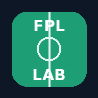

<h1 align="center">FPL Lab</h1>

  <b>A Fantasy Premier League assistant that shows its working.</b> 
  Projections built from every shot, every minute and every fixture, explained in plain English, 
  tested against FPL's own numbers, and updated automatically every day.

  <a href="https://charleswoosnam01-collab.github.io/fpl-lab/"><b>Open the app</b></a> ·
  <a href="#what-it-does">What it does</a> ·
  <a href="#how-the-model-works">How it works</a> ·
  <a href="#how-accurate-is-it">Accuracy</a> ·
  <a href="SETUP.md">Setup guide</a>

  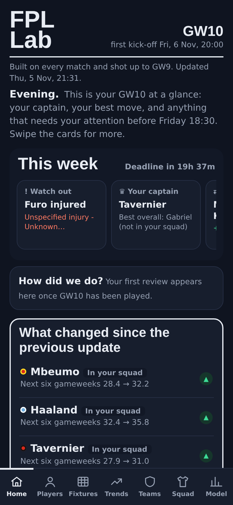
  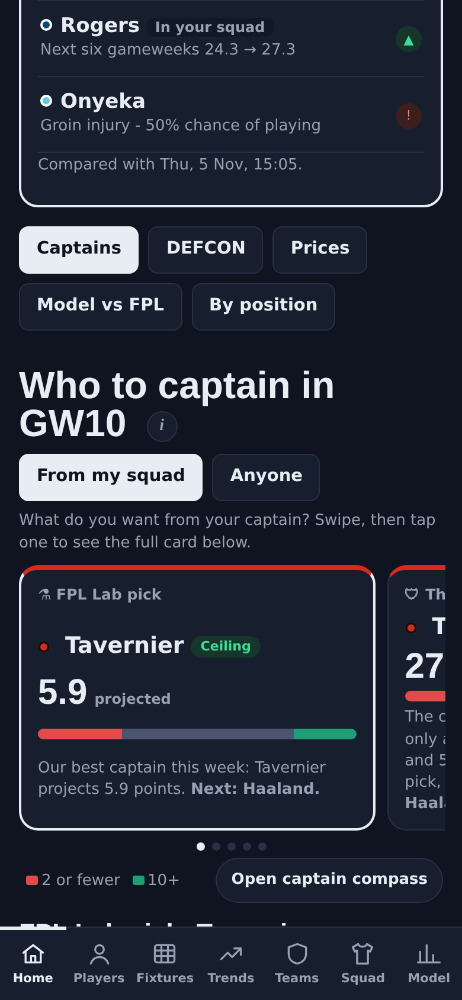
  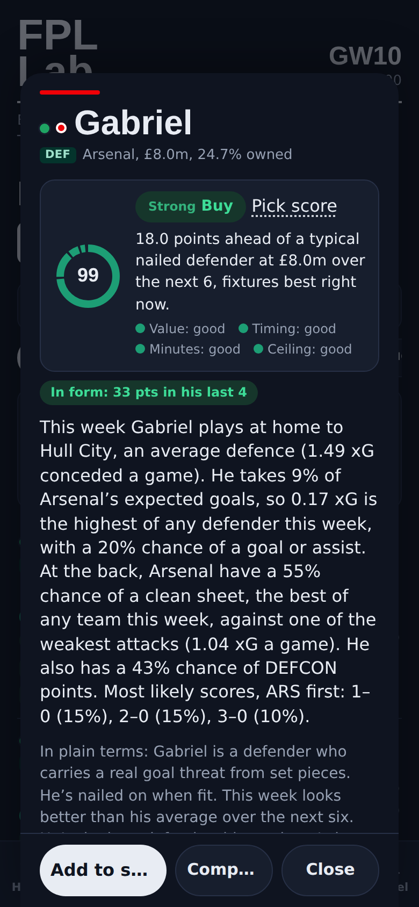
  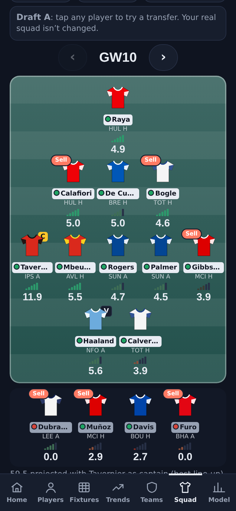

---

## What FPL Lab is

FPL Lab is a free web app for Fantasy Premier League managers. Every day it pulls the latest match data, rates every team, projects every player for the next six gameweeks, simulates each player's next match 3,000 times, checks its own accuracy against what actually happened, and publishes the results as an app you can open on your phone.

Three ideas run through it:

- **Every number has a reason.** Tap any player, team or verdict and you get the explanation in plain English: where his points come from, why his fixture is good or bad, and what would change the picture.
- **Every model choice is tested.** Nothing goes into the projections because it sounds clever. Ideas are tested on past seasons first, and the ones that didn't improve accuracy were left out (see [what was tested and rejected](#what-was-tested-and-rejected)).
- **Glanceable first, detail on tap.** Colours, signal bars and short tags tell you the answer at a glance; the full working sits one tap away.

It runs entirely on free services: GitHub runs the engine on a schedule and GitHub Pages hosts the app. It installs to your home screen like a normal app.

---

## What it does

### 🏠 Home

Your gameweek in one place, ordered by what matters now: before the deadline it leads with your three decisions (captain, transfer, the most urgent alert), then your XI, your captain, your best transfer, alerts for your players and watchlist, chips when a window is close, and your leagues. During matches the live score comes first; after the gameweek, the review.

- **A greeting and your week at a glance**, with the deadline countdown.
- **Stacked cards in the order that matters this week**: your three decisions, your XI, captain, transfer (with a plain "worth doing" label and a hit check), alerts, chips and leagues.
- **Live gameweek scores** every 15 minutes during matches, with provisional bonus and auto-subs, which turn into a **gameweek review** once the last match finishes: your points, how your captain did against the best pick you had, and your best and worst players.
- **"How did we do?"**: last week's forecasts scored against what actually happened.
- **"What changed"**: verdict changes, projection swings, injury news and price changes since your last visit.
- **A watchlist and search**: star any player to follow him from Home, and find any player or team from the magnifier at the top.
- **A status strip** under the header that changes through the week: live scores, the final score, or the deadline countdown.

 

### 👑 Captain (its own tab)

Swipeable cards answer one question: *what do you want from your captain this week?*

| Card | What it picks |
|---|---|
| **FPL Lab pick** | The model's best captain, on projected points |
| **The easy choice** | The captain least likely to let you down: the smallest chance of 2 points or fewer |
| **Ceiling** | The highest chance of a 10+ haul |
| **Gain rank** | A strong haul chance that few managers own, so a big week moves you up |
| **Top 500's pick** | What the best 500 managers are backing (their actual captains once the deadline passes) |

- Switch between **From my squad** and **Anyone**; if the best overall pick isn't in your team, it tells you.
- Each card shows a bar of blank, typical and haul chances from the simulations.
- The **captain compass** plots the top ten options by safety against haul chance, with dot size showing ownership.

 

### 👤 Players

- **Every player ranked and filterable**: by projected points, pick score, value, haul chance, xG, xA, box touches, DEFCON chance, price changes, top-manager ownership and more. Tap any sort again to flip it.
- **Quick views**: Differentials, In form, Due a return.
- **Verdicts on every player**: **Buy, Watch, Don't buy** (or **Hold** and **Sell** for your own players), driven by a **pick score from 0 to 100**. The pick score is mostly how many points he projects over the next six weeks compared with a typical nailed player at his price, plus fixture timing, minutes security and ceiling. The weights were fitted on last season.
- **A small set of tags on each row**: position, minutes light (green, amber or red), player type (*Goal threat, Creator, Clean-sheet defender, DEFCON earner…*) and outcome shape (*Ceiling, Boom or bust, Safe floor*).

**Each player's page includes:**
- The verdict with its reason and a score ring
- A plain-English summary of this week's fixture, the most likely scores and his share of his team's chances
- **Where his points come from**, as blocks you can count, compared with a typical player in his position
- Next six gameweeks, form match by match, a percentile radar, a shot map and matchup notes
- A **role tracker** for midfielders: deep, mixed or advanced, game by game
- The range of outcomes from 3,000 simulations
- What-ifs: *if recent form continues* and *on home/away record*
- Minutes and rotation, including cup and European games either side
- Better options at the same price

 

  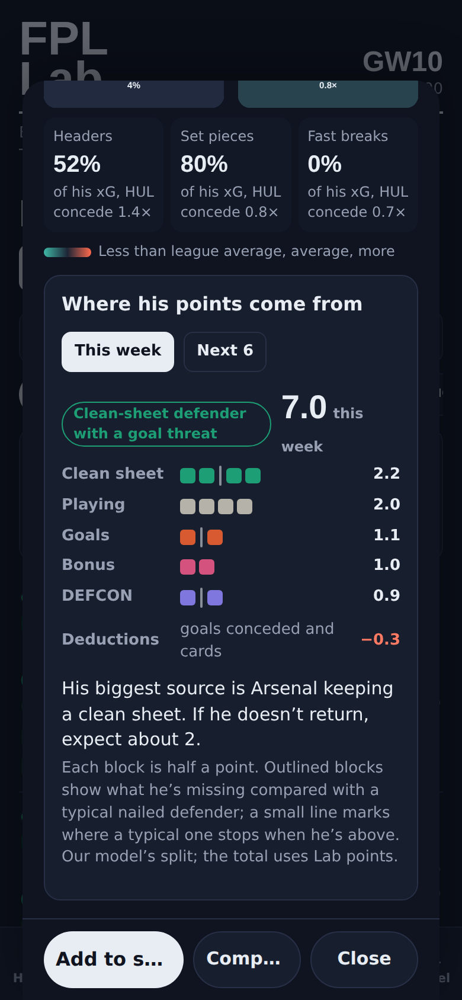
  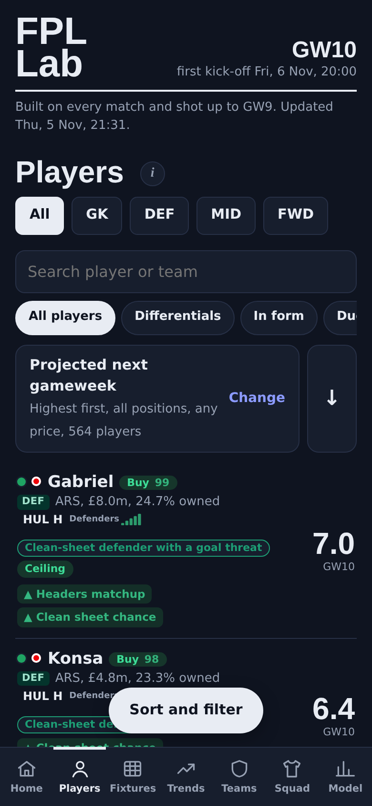

### 📅 Fixtures

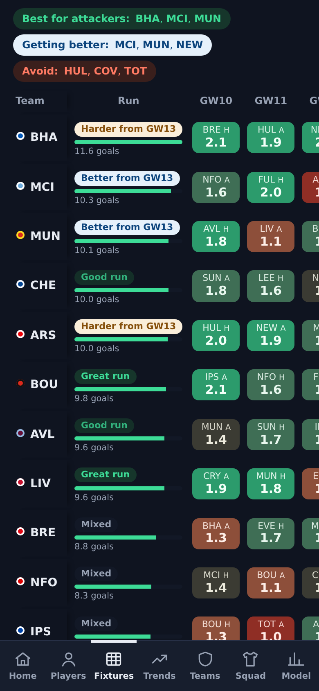

- **Split fixture difficulty**: one view for **attackers** (goals the team is expected to score) and one for **defenders** (clean sheet chance), for the next 3, 6 or 10 gameweeks.
- **Run tags and chips**: *Great run, Better from GW12, Harder from GW13*, plus "Best for attackers", "Getting better" and "Avoid".
- **Likely scores** for every match.
- **Swings**: who's getting easier or harder.
- **Bookies vs model**: each match as a card with a win/draw/loss bar, bookmaker and model goals side by side, and what any disagreement means for FPL.
- **Referees** (penalty and card records) and **rotation** around cup and European games.

 

### 📈 Swings (Fixtures › Swings, with Fixtures and Form)

- Each team's **next-four forecast against its last four**, as a dumbbell chart.
- **Heating up** and **cooling down**, with reasons.
- Attackers to get ahead of, and ones to think about selling.
- **Surprise runs**: teams beating the model's forecast, with how often that kind of run lasts.
- A **track record** of this season's calls.

### 🛡️ Teams

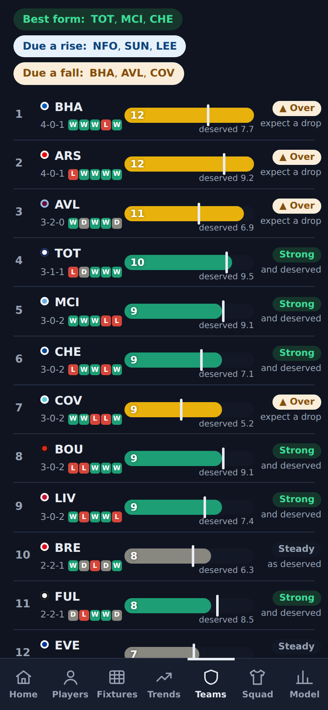

- **Team tiles**: attack and defence ratings, trend, next three fixtures and one plain FPL call (*Buy attackers, Buy defenders, Buy both, Wait, Avoid*).
- **Quality map**: attack against defence, in quadrants (*Target both, Defenders only, Attackers only, Avoid*).
- **Form map**: attack quality against recent trend.
- **Form table**: real points as a bar, deserved points as a line, with **▲ Over / ▼ Under / Strong / Poor** tags, and *Best form, Due a rise, Due a fall* chips.
- **Luck table**: finishing and goalkeeping luck at both ends, as diverging bars.
- **Head to head**, set pieces, and a full page for every team.

 

  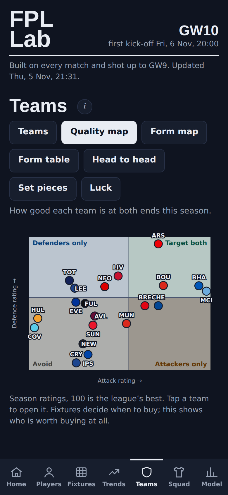

### 👕 Squad

- **Your team on a pitch**, in club-coloured shirts, with captain, vice-captain, swaps and minutes edits, for any gameweek.
- **Draft transfers on the pitch**: tap a player, choose *Transfer out*, and pick from affordable replacements ranked by pick score. Free transfers, bank, hits and the six-week points change update as you go. Plan several weeks ahead in separate drafts (A, B, C…).
- **The planner**: lock players, sell-by and buy-by rules, bans, chips and settings. An **exact optimiser** (the HiGHS solver, running in your browser) finds the best six-week plan around your choices, with alternatives and a stress test.
- **Chip calendar**: the best week for Triple Captain, Bench Boost and Free Hit. Weeks are compared as if the player stays fit, with a **risk-of-waiting** note alongside.
- **Health check, best XI, squad fixture grid and season review** (transfers, captains, bench points, rank).
- **Mini leagues**: every classic league you're in, in a dropdown. For each one: your rank, the points to catch the manager above, the leader's weak spot, threats (their players you don't have), your edge, and **"to get ahead"** picks few of them own.

 

### 📊 Model (the gear icon at the top)

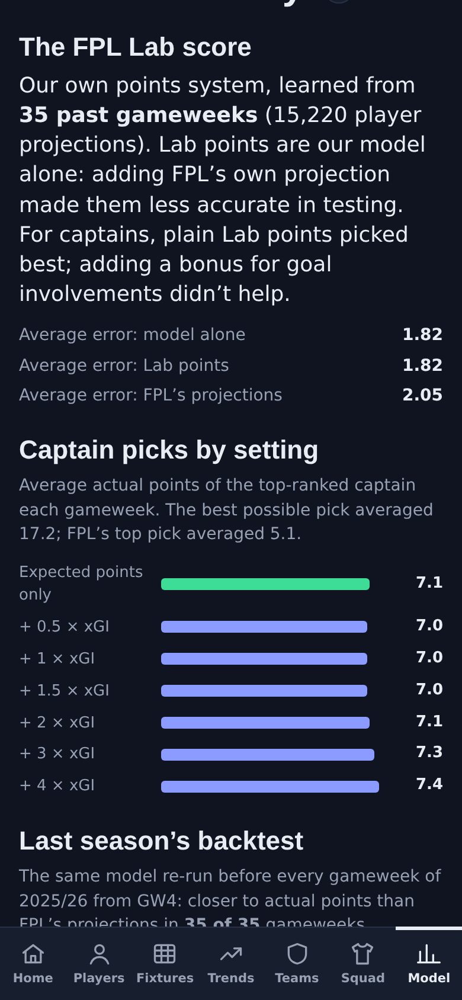

- **Accuracy**: this season and last, against FPL's own projections.
- **Captain picks by setting**, the live accuracy log and the biggest misses.
- **Data sources**: what was used in each run, and why anything wasn't.
- **Safety checks**: what every update had to pass before going live.
- **Every test** and what it decided.
- **Export and import your settings**, plus a glossary of every term.

 

---

## How the model works

<b>Team ratings</b>

Each team gets an attack and a defence rating from expected goals (the quality of every chance created and allowed), with recent games counting more, a quarter weight on actual goals, and an adjustment for who they've played. Ratings start from last season's figures, pulled a third of the way towards average, and this season takes over week by week: about 65% this season after nine gameweeks, rising to about 80% by the end. Home advantage is measured from the data each run (about 18% more goals at home).

<b>Player roles and points</b>

Each player's share of his team's chances (non-penalty xG and xA) is measured from recent games and steadied towards a sensible starting point when the sample is small. Penalties go only to the current first-choice taker. Expected minutes come from his starts and minutes, cup and European games either side, and injury news. Clean sheets, goals conceded, saves, bonus, cards and **DEFCON** points are each modelled against the specific opponent. Players near a yellow-card ban (five league bookings by their club's 19th match, ten by the 32nd) have their projections lowered for the matches they might miss, using a booking rate tested on last season.

<b>Bookmakers and referees</b>

For the coming gameweek, bookmaker prices (via The Odds API) are turned into expected goals and blended with the model. The blend was set by testing against closing odds, and currently leans 90% on the market. Referee records adjust penalty and card chances for first-choice takers.

<b>Simulations and outcome shape</b>

Each player's next match is simulated 3,000 times to give haul chance (10+), blank chance (2 or fewer), the range of outcomes and the *Ceiling, Boom or bust* and *Safe floor* tags.

<b>Lab points and the captain ranking</b>

Lab points are the model's own projection. FPL's published projection was tested as an extra ingredient: it made predictions slightly worse, and straight after a haul it badly overrated players (forecasting 5.8 for players who went on to average 3.6), so it counts for 0%. The tuner re-checks this on every run. For captains, plain projected points picked the best captains; adding a bonus for goals and assists didn't help.

<b>Future weeks</b>

Weeks further ahead are projected as if each player stays fit. Injuries, suspensions and team news change them as the news arrives. Where waiting matters (chip timing and later transfers), a separate **risk-of-waiting** note shows how often nailed players weren't starting that far ahead last season, without changing the projection.

---

## How accurate is it?

| | FPL Lab | FPL's own projections |
|---|---|---|
| **Average error per player, last season** (35 gameweeks) | **2.04 points** | 2.29 points |
| Gameweeks where FPL Lab was more accurate | **35 of 35** | |
| **Average error, this season** (to GW9) | **2.08 points** | 2.36 points |
| **Captain pick, average points a week** | **7.1** | 5.1 (FPL's top pick) |

Error by position, last season:

| | Goalkeepers | Defenders | Midfielders | Forwards |
|---|---|---|---|---|
| FPL Lab | **1.42** | **1.99** | **1.70** | **1.89** |
| FPL | 1.73 | 2.18 | 1.95 | 2.12 |

A live log scores the forecasts saved before each deadline against what actually happened, every gameweek.

### What was tested and rejected

| Idea | Result |
|---|---|
| Separate home and away strength in the projections | Worse on 369 matches; kept as an optional what-if view |
| Extra weight on the last four games | Worse on 370 matches; kept as an optional what-if view |
| Blending in FPL's own projection | 0% beat 5% in every one of 2,000 resamples |
| A results-based Elo rating (like ClubElo) | Slightly worse than the xG-based ratings |
| A captain bonus for goals and assists | No better than plain projected points |
| Boosting players rested in midweek | Worse; they simply lose the rotation flag |
| Momentum from short hot streaks | Teams beating their forecast over two games kept it up only 38% of the time |

---

## Data sources

| Source | Used for |
|---|---|
| **[FPL Core Insights](https://github.com/olbauday/FPL-Core-Insights)** | Every match and shot (location, body part, situation), touches, passes, DEFCON actions, cup and European minutes |
| **Official FPL API** | Prices, ownership, injury news, set-piece and penalty takers, fixtures, your team, your leagues, top-500 managers, live scores |
| **The Odds API** | Bookmaker prices for the coming gameweek |
| **football-data.co.uk** | Referee records, closing odds for calibration, backup odds |
| **Last season's data** | Starting points for teams and players, and the backtests |

Switched off after testing: ClubElo (no accuracy gain) and Understat (it now blocks automated requests, and was only ever a second opinion).

---

## Updates and reliability

- **Automatic updates**: the engine runs on GitHub on a schedule after each data refresh, and every 15 minutes during matches for live scores.
- **Safety net**: every update must pass checks (enough players and fixtures, sensible projections, no impossible numbers, normal accuracy) before it replaces the live data. If anything looks wrong, yesterday's numbers stay up and the run is flagged.
- **Deadline reminder**: an optional phone notification the day before each deadline.

---

## Design

- **Mobile-first**: built for a phone and installable to the home screen. It works in Safari and Chrome, with an offline fallback.
- **Light and dark mode**, following your phone's setting.
- **Plain English everywhere**, with tappable terms explained in the glossary.
- **Colour that means something**:
  - green for good and red for bad;
  - signal bars for fixtures;
  - club colours on cards;
  - position labels (**GK** amber, **DEF** green, **MID** blue, **FWD** red);
  - and calm everywhere else.
- **Your data stays on your device**: your squad, drafts, rules and minute edits are saved in your browser, with export and import to back them up.

  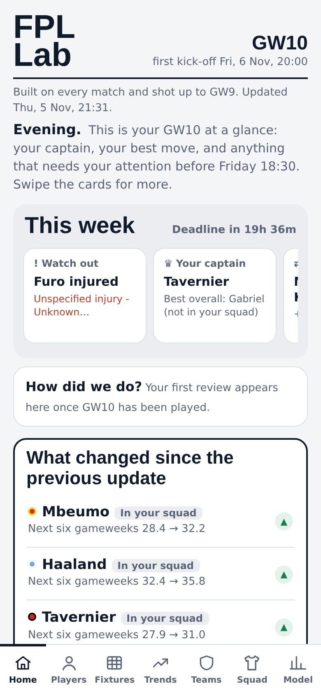
  

---

## Under the hood

- **Engine**: Python (pandas, NumPy, SciPy) in `engine/fpl_engine.py`, run by GitHub Actions, writing `site/data.json`.
- **App**: one self-contained HTML file in plain JavaScript, with no framework and no build step, in `site/index.html`.
- **Optimiser**: HiGHS (MIT licence), compiled to WebAssembly and running in the browser.
- **Hosting**: GitHub Pages. **Cost**: free.

To run your own copy, see the **[setup guide](SETUP.md)**.

---

  FPL Lab is an independent fan project. It isn't affiliated with or endorsed by the Premier League or Fantasy Premier League. 
  Match data from <a href="https://github.com/olbauday/FPL-Core-Insights">FPL Core Insights</a> and the official FPL API. Projections are estimates, not guarantees.

